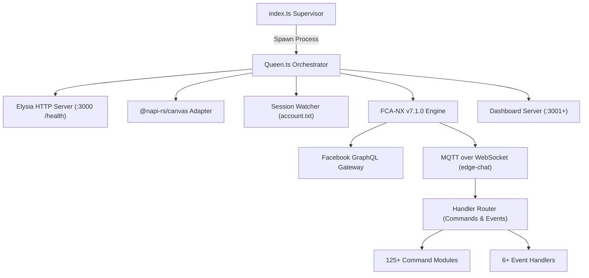

<div align="center">

# 👑 QueenBot v3

<p align="center">
  <b>The Ultimate High-Performance Facebook Messenger Bot Framework</b><br>
  <i>Engineered with TypeScript, Powered by Bun.js & Node.js 20+, Featuring Next-Gen FCA-NX Engine</i>
</p>

[](https://github.com/ItzPriyanshi/QueenBotV3)
[](https://bun.sh)
[](https://nodejs.org/)
[](https://www.typescriptlang.org/)
[](LICENSE)
[](https://github.com/ItzPriyanshi)

```txt
  ██████╗ ██╗   ██╗███████╗███████╗███╗   ██╗    ██╗   ██╗██████╗ 
 ██╔═══██╗██║   ██║██╔════╝██╔════╝████╗  ██║    ██║   ██║╚════██╗
 ██║   ██║██║   ██║█████╗  █████╗  ██╔██╗ ██║    ██║   ██║ █████╔╝
 ██║▄▄ ██║██║   ██║██╔══╝  ██╔══╝  ██║╚██╗██║    ╚██╗ ██╔╝ ╚════██╗
 ╚██████╔╝╚██████╔╝███████╗███████╗██║ ╚████║     ╚████╔╝ ██████╔╝
  ╚══▀▀═╝  ╚═════╝ ╚══════╝╚══════╝╚═╝  ╚═══╝      ╚═══╝  ╚═════╝ 
```

</div>

---

## 🌟 Overview

**QueenBot v3** is a modernized, ultra-fast Facebook Messenger bot framework designed from the ground up for extreme speed, rock-solid stability, and zero configuration friction. 

Built with **100% TypeScript** and optimized for **Bun.js** (with native **Node.js 20+** fallback), QueenBot v3 drops all legacy bloat, cuts startup overhead, and delivers seamless compatibility with modern Facebook Messenger protocols via the latest **fca-nx 7.1.0** engine.

---

## ✨ What's New in v3.3.0

- 🚀 **Dual Runtime Engine**: Run natively under **Bun.js** (`bun run index.ts`) for sub-second cold starts and reduced memory footprint, or under **Node.js 20+** (`npm run start:node`) with complete parity.
- ⚡ **Next-Gen FCA-NX (v7.1.0)**: Built on the latest FCA-NX protocol core with automatic session activation, enhanced GraphQL batching, and resilient MQTT listeners.
- 🎨 **Native Rust Canvas Adapter**: Injected `@napi-rs/canvas` compatibility bridge providing 100% native Node-Canvas API support (`createCanvas`, `loadImage`, `registerFont`, `createPNGStream`) without node-gyp C++ build errors on Windows or Linux.
- 🔄 **Hot Account Watcher & Live Re-auth**: Monitors `account.txt` in real time. If a session expires or fresh cookies are saved, QueenBot immediately detects changes and authenticates automatically without process restarts.
- 🛡️ **Port Conflict Auto-Escalation**: Dashboard server safely identifies port collisions (e.g. `EADDRINUSE: 3001`) and auto-escalates to available ports (`3002+`) without crashing.
- 🎵 **Direct Media & Music Streaming**: Stream tracks instantly via `.music <song name>` and `.sing <query>` with dynamic iTunes & YouTube resolvers.
- 📊 **Glassy Anime Uptime Card**: Built-in `.uptime2` generating dynamic system telemetry images (CPU, RAM, Ping, OS stats) on the fly.
- 🧹 **Clean Zero-Bloat Core**: Removed obsolete Gmail API, Nodemailer, and Google OAuth dependencies. Everything authenticates cleanly via your `account.txt` appState JSON.

---

## 🏗️ Architecture



---

## 📁 Repository Structure

```
QueenBotV3/
├── bot/
│   ├── canvasAdapter.js          # High-performance @napi-rs/canvas bridge
│   ├── custom.ts                 # Scheduled maintenance & DTSG refresher
│   ├── autoUptime.ts             # 24/7 keepalive pinger
│   ├── handler/
│   │   ├── handlerAction.ts      # Main event router & lifecycle dispatcher
│   │   ├── handlerCheckData.ts   # Database user/thread synchronization
│   │   └── handlerEvents.ts      # Command executor, cooldowns & permissions
│   └── login/
│       ├── login.ts              # Authentication & resilient connection manager
│       ├── loadData.ts           # Database initialization (MongoDB / SQLite)
│       ├── loadScripts.ts        # Dynamic command loader & tools synchronizer
│       ├── checkLiveCookie.ts    # Comprehensive cookie health validator
│       └── socketIO.js           # Real-time dashboard websocket server
├── dashboard/                    # Web-based management dashboard
├── scripts/
│   ├── cmds/                     # 125+ TypeScript command modules (.ts)
│   └── events/                   # 6+ TypeScript lifecycle event modules (.ts)
├── database/                     # Models and data controllers
├── languages/                    # Multilingual localization bundles (en, vi)
├── Queen.ts                      # Main bot runtime orchestrator
├── index.ts                      # CLI entrypoint & process supervisor
├── config.json                   # Main bot configuration
├── package.json                  # Dependencies & scripts (v3.3.0)
└── tsconfig.json                 # TypeScript compiler configuration
```

---

## 🛠️ Quick Start

### 1. Prerequisites

- **Bun.js** *(Recommended)*: [https://bun.sh](https://bun.sh)
  ```powershell
  # Windows (PowerShell)
  powershell -c "irm bun.sh/install.ps1 | iex"
  ```
  *OR*
- **Node.js**: v18.0.0 or higher ([https://nodejs.org](https://nodejs.org))

---

### 2. Installation

Clone this repository and install dependencies:

```bash
git clone https://github.com/ItzPriyanshi/QueenBotV3.git
cd QueenBotV3
```

Install packages using Bun:
```bash
bun install
```
*(Or with npm: `npm install`)*

---

### 3. Session Setup (Cookies)

QueenBot v3 uses Facebook `appState` JSON cookies:

1. Open your browser and log into your Facebook account.
2. Export your cookies in JSON format using a browser extension like **Cookie-Editor** or **C3C FbState**.
3. Create a file named `account.txt` in the root folder and paste the exported JSON array:

```json
[
  {
    "key": "c_user",
    "value": "YOUR_UID",
    "domain": "facebook.com",
    "path": "/",
    "hostOnly": false
  },
  {
    "key": "xs",
    "value": "YOUR_XS_TOKEN",
    "domain": "facebook.com",
    "path": "/",
    "hostOnly": false
  }
]
```

> [!NOTE]
> `account.txt` is strictly ignored by `.gitignore` to keep your credentials safe.

---

### 4. Running the Bot

#### Mode A: With Bun (Fastest)
```bash
bun start
```

#### Mode B: Development Mode (Auto-Reload on Code Edit)
```bash
bun run dev
```

#### Mode C: With Node.js 20+
```bash
npm run start:node
```

---

## ⚙️ Configuration (`config.json`)

Key settings in `config.json`:

```json
{
  "prefix": ".",
  "botName": "꧁𝑄𝑢𝑒𝑒𝑛𝐵𝑜𝑡꧂",
  "author": "Priyanshi Kaur",
  "adminBot": ["YOUR_UID"],
  "language": "en",
  "database": {
    "type": "mongodb",
    "uriMongodb": "your_mongodb_connection_string"
  },
  "dashBoard": {
    "enable": true,
    "port": 3001
  },
  "optionsFca": {
    "forceLogin": true,
    "listenEvents": true,
    "updatePresence": true,
    "listenTyping": true,
    "autoReconnect": true
  }
}
```

---

## 💬 Featured Commands

| Command | Usage | Description | Access |
| :--- | :--- | :--- | :--- |
| **`help`** | `.help [command]` | Displays interactive command menu or detailed usage guide | All |
| **`prefix`** | `Prefix` / `.prefix <char>` | Views or updates the bot trigger prefix | All / Admin |
| **`uptime2`** | `.uptime2` | Renders a glassy anime status card with real-time CPU/RAM/Ping telemetry | All |
| **`music`** | `.music <song name>` | Searches iTunes library and streams the audio clip directly | All |
| **`sing`** | `.sing <query or URL>` | Downloads and streams high-definition audio/video from YouTube | All |
| **`theme`** | `.theme [id]` | Displays available Messenger themes or applies a custom palette | Admin / Thread Admin |
| **`uid`** | `.uid [@mention]` | Retrieves your own Facebook UID or the target user's UID | All |
| **`tid`** | `.tid` | Displays current thread / group conversation ID | All |
| **`pin`** | `.pin` (reply) | Pins replied message to the top of the group chat | Thread Admin |
| **`restart`** | `.restart` | Gracefully reloads and restarts the bot process | Bot Admin |

---

## 🛡️ Anti-Ban & Production Tips

- **Use Aged Accounts**: Avoid running bots on brand-new Facebook accounts. Accounts older than 6 months are significantly less prone to security checkpoints.
- **2-Factor Authentication**: Always keep 2FA enabled on your Facebook account.
- **Keep Cookies Private**: Never share your `account.txt` file or commit it to a repository.
- **Reasonable Cooldowns**: Keep default command cooldowns (1-3s) to avoid triggering Meta anti-spam filters.

---

## 📜 License & Credits

- **Author**: [Priyanshi Kaur](https://github.com/ItzPriyanshi)
- **Repository**: [QueenBotV3](https://github.com/ItzPriyanshi/QueenBotV3)
- **Engine**: Powered by `fca-nx`, `elysia`, `@napi-rs/canvas`, and `bun`
- **License**: [MIT License](LICENSE)

<div align="center">
  <b>Built with ❤️ by Priyanshi Kaur</b>
</div>
